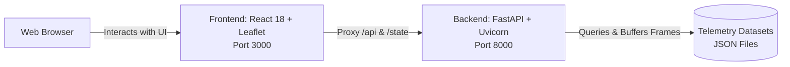

# Spatial Playback & Telemetry — Operations Runbook

This runbook provides isolated, step-by-step procedures for managing the **Backend** and **Frontend** independently. Each service has its own **First-Time Installation** process and **Regular Daily Running** commands so you can track and operate them separately.

---

## ⚡ Quick Daily Launch (TL;DR)

### Option A: One-Command Multi-Terminal Script (Recommended)
Run this single PowerShell script from the project root — it automatically opens both Backend and Frontend in separate dedicated terminal windows with zero policy errors:
```powershell
powershell -ExecutionPolicy Bypass -File .\run.ps1
```

---

### Option B: Manual Two-Terminal Launch

#### Terminal 1 — Backend
```powershell
cd Backend
Set-ExecutionPolicy -Scope Process -ExecutionPolicy RemoteSigned
.\venv\Scripts\Activate.ps1
python -m uvicorn app.main:app --reload
```
> **Backend URL:** [http://127.0.0.1:8000](http://127.0.0.1:8000) | **Swagger API Docs:** [http://127.0.0.1:8000/docs](http://127.0.0.1:8000/docs)

#### Terminal 2 — Frontend
```powershell
cd frontend
npm.cmd run dev
```
> *(Or if you want to use `npm run dev`, run `Set-ExecutionPolicy -Scope Process -ExecutionPolicy RemoteSigned` first)*
> 
> **Frontend Web App:** [http://localhost:3000](http://localhost:3000)

---

## System Architecture



---

# 🛠️ SECTION 1: BACKEND RUNBOOK

Manage all backend operations, environment setup, data generation, and API server execution here.

### 1.1 Backend Prerequisites
- **Python**: Version `3.10` or higher (`python --version`)
- **Virtual Environment**: Python built-in `venv` module

---

### 1.2 Backend First-Time Installation (One-Time Setup)

Run these commands once to configure your isolated Python environment and install all backend requirements:

#### Step 1: Open Terminal at Project Root
```powershell
cd c:\Users\satya\Downloads\Projects\spatial-playback
```

#### Step 2: Create the Virtual Environment
```powershell
python -m venv .venv
```

#### Step 3: Activate the Virtual Environment
- **PowerShell (Windows)**:
  ```powershell
  # If script execution is blocked on your system, enable it for this session:
  Set-ExecutionPolicy -Scope Process -ExecutionPolicy RemoteSigned

  .\.venv\Scripts\Activate.ps1
  ```
- **Command Prompt (`cmd.exe`)**:
  ```cmd
  .venv\Scripts\activate.bat
  ```
- **Git Bash / macOS / Linux**:
  ```bash
  source .venv/Scripts/activate
  ```
*(When activated, your terminal prompt will show `(.venv)`).*

#### Step 4: Upgrade `pip` and Install Backend Requirements
```powershell
python -m pip install --upgrade pip
pip install -r Backend/requirements.txt
```
> **Packages installed:**
> - `fastapi>=0.115.0` (High-performance API framework)
> - `uvicorn[standard]>=0.32.0` (ASGI server with reload support)
> - `pydantic>=2.10.0` (Data validation and schemas)
> - `python-multipart>=0.0.12` (Form & upload support)

#### Step 5: Generate Sample Data (Initial Dataset)
Generate the sample `data.json` trajectory file used by the default playback scenario:
```powershell
python Backend/generate_data.py
```
*Expected confirmation: `data.json generated`.*

#### Step 6: Verify Backend Installation
Test that all required libraries import cleanly:
```powershell
python -c "import fastapi, uvicorn, pydantic; print('Backend modules successfully installed!')"
```

---

### 1.3 Backend Regular Running (Daily Workflow)

For daily development or testing, use these exact commands:

```powershell
cd Backend
Set-ExecutionPolicy -Scope Process -ExecutionPolicy RemoteSigned
.\venv\Scripts\Activate.ps1
python -m uvicorn app.main:app --reload
```

> [!NOTE]
> **Why `app.main:app` instead of `Backend.app.main:app`?**
> When you `cd Backend`, your working directory is inside the `Backend` folder. Uvicorn locates the `app` package directly from your current directory.

#### Alternative Launch Methods:
- **From Project Root (without `cd Backend`)**:
  ```powershell
  .\.venv\Scripts\Activate.ps1
  python -m uvicorn Backend.app.main:app --reload
  ```
- **Direct Entrypoint Script**:
  ```powershell
  python Backend/app.py
  ```

#### Backend Endpoints & Verifications
Once running, verify through any browser or curl command:
- **Health Check**: [http://127.0.0.1:8000/health](http://127.0.0.1:8000/health)
  ```json
  {"status": "healthy", "service": "spatial-playback-api", "version": "2.0.0"}
  ```
- **Interactive API Docs (Swagger UI)**: [http://127.0.0.1:8000/docs](http://127.0.0.1:8000/docs)
- **ReDoc Documentation**: [http://127.0.0.1:8000/redoc](http://127.0.0.1:8000/redoc)
- **Scenario Catalog**: [http://127.0.0.1:8000/api/scenarios](http://127.0.0.1:8000/api/scenarios)
- **Legacy State Endpoint**: [http://127.0.0.1:8000/state?t=0](http://127.0.0.1:8000/state?t=0)

#### Stopping the Backend Server
- Press `Ctrl + C` in the terminal to terminate the server.

---

# 💻 SECTION 2: FRONTEND RUNBOOK

Manage all frontend operations, UI dependencies, Vite dev server, and production builds here.

### 2.1 Frontend Prerequisites
- **Node.js**: Version `18.0.0` or higher (`node --version`)
- **npm**: Version `9.0.0` or higher (`npm.cmd --version` or `npm -v`)

---

### 2.2 Frontend First-Time Installation (One-Time Setup)

Run these commands once to install all UI libraries and dependencies:

#### Step 1: Navigate to the `frontend` Directory
```powershell
cd c:\Users\satya\Downloads\Projects\spatial-playback\frontend
```

#### Step 2: Install Node Dependencies
On Windows PowerShell, use `npm.cmd` if standard `npm` is blocked by Windows execution policy:
```powershell
npm install
# (If PowerShell blocks script execution, use: npm.cmd install)
```
> **Packages installed:**
> - `react`, `react-dom` (v18.3.1)
> - `leaflet` (v1.9.4 - Geospatial mapping engine)
> - `lucide-react` (v0.468.0 - UI icons)
> - `vite`, `@vitejs/plugin-react` (Fast build tool and dev server)

#### Step 3: Verify Frontend Build
Verify that the project bundles cleanly for production:
```powershell
npm run build
# (Or: npm.cmd run build)
```
*Expected confirmation: `✓ built in ...` with outputs generated in `frontend/dist`.*

---

### 2.3 Frontend Regular Running (Daily Workflow)

For daily development or UI testing, use:

#### Start the Frontend Dev Server (Windows PowerShell)
```powershell
cd frontend
npm.cmd run dev
```

> [!NOTE]
> **Why `npm.cmd`?**
> On Windows PowerShell, running bare `npm` executes `npm.ps1`, which is blocked by PowerShell's default script execution policy (`Restricted`). Using `npm.cmd` runs the native Windows binary without any permission errors!
> Alternatively, if you prefer `npm run dev`, run `Set-ExecutionPolicy -Scope Process -ExecutionPolicy RemoteSigned` in that terminal once first.

#### Accessing the Web Application
Open your web browser and navigate to:
- **Web UI**: [http://localhost:3000](http://localhost:3000)

> [!TIP]
> Vite automatically proxies API requests (`/api` and `/state`) to the backend at `http://127.0.0.1:8000`. Always ensure the backend is running so the frontend can load scenario data seamlessly.

#### UI Controls & Keyboard Shortcuts
When viewing the application in your browser:
- `Space`: Toggle Play / Pause
- `Arrow Left`: Step Backward (-1 timestep)
- `Arrow Right`: Step Forward (+1 timestep)
- `R` or `r`: Reset to initial frame (t=0)
- **Top Header**: Switch between scenarios, toggle motion trails, switch base map (Dark / Satellite), or open Custom Trajectory Upload.

#### Stopping the Frontend Dev Server
- Press `Ctrl + C` in the terminal to stop Vite.

---

# 🔧 SECTION 3: TROUBLESHOOTING & WINDOWS PITFALLS

### 1. Why Did `.\venv\Scripts\activate : The term ... is not recognized` Happen?
- **Root Cause 1 (Path & Folder Name)**:
  The virtual environment directory was originally created at the repository root as `.venv` (with a dot `.` in front). When you executed `cd backend` first, typing `.\venv\Scripts\activate` failed because there was no folder named `venv` inside `backend`.
  *(A directory link `Backend\venv -> .venv` has now been created so `cd Backend` -> `.\venv\Scripts\Activate.ps1` works immediately!)*
- **Root Cause 2 (PowerShell Script Policy)**:
  Windows PowerShell restricts executing `.ps1` script files by default (`Restricted` policy).
  To resolve this, run this once in your PowerShell terminal:
  ```powershell
  Set-ExecutionPolicy -Scope Process -ExecutionPolicy RemoteSigned
  ```
- **Why did uvicorn still start?**
  Even though activating the virtual environment threw an error, your global system Python happened to have `fastapi` and `uvicorn` installed, so `python -m uvicorn app.main:app --reload` successfully ran using the system Python. Running with `Activate.ps1` ensures all virtual environment packages are correctly isolated.

---

### 2. PowerShell Script Execution Error (`npm.ps1` or `Activate.ps1`)
- **Symptom**: `File ... cannot be loaded because running scripts is disabled on this system`.
- **Fix A**: Unblock script execution for the active PowerShell session:
  ```powershell
  Set-ExecutionPolicy -Scope Process -ExecutionPolicy RemoteSigned
  ```
- **Fix B (for npm)**: Use the Windows command wrapper:
  ```powershell
  npm.cmd install
  npm.cmd run dev
  ```

---

### 3. Address Already in Use (Port 8000 or 3000)
- **Symptom**: `[Errno 10048] error while attempting to bind on address ('127.0.0.1', 8000): address already in use` or Vite port conflict.
- **Solution (Find and Kill process on Windows)**:
  ```powershell
  # Find PID occupying the port:
  netstat -ano | findstr :8000

  # Terminate the process using its PID (replace <PID> with the number shown in rightmost column):
  taskkill /PID <PID> /F
  ```

---

## 📋 Command Reference Summary

| Operation | Backend (Terminal 1) | Frontend (Terminal 2) |
| :--- | :--- | :--- |
| **Directory** | `cd Backend` | `cd frontend` |
| **First-Time Setup** | `python -m venv .venv`<br/>`Set-ExecutionPolicy -Scope Process -ExecutionPolicy RemoteSigned`<br/>`.\venv\Scripts\Activate.ps1`<br/>`pip install -r requirements.txt`<br/>`python generate_data.py` | `npm install` (or `npm.cmd install`)<br/>`npm run build` |
| **Regular Running** | `Set-ExecutionPolicy -Scope Process -ExecutionPolicy RemoteSigned`<br/>`.\venv\Scripts\Activate.ps1`<br/>`python -m uvicorn app.main:app --reload` | `npm.cmd run dev` (or `npm run dev`) |
| **Stop Server** | `Ctrl + C` | `Ctrl + C` |
| **Active URL** | [http://127.0.0.1:8000](http://127.0.0.1:8000) | [http://localhost:3000](http://localhost:3000) |
| **Docs URL** | [http://127.0.0.1:8000/docs](http://127.0.0.1:8000/docs) | N/A |
